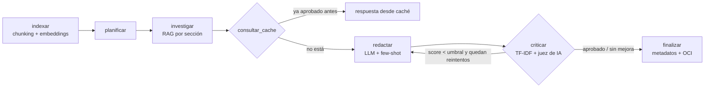

# NuevaMente 🎓 — Kairos G10

**Versión 1.4** (Sprint 4). La versión sigue el sprint: 1.N = Sprint N; se define en `src/nuevamente/__init__.py` y se muestra en el pie de la interfaz y en `/health`.

Sistema Inteligente de Adaptación y Generación de Contenido Educativo.
**Hackathon ONE G10** (Oracle Next Education & Alura) — Proyecto 1.
Equipo **Kairos G10** (G10-LATAM-equipo 41) · Nicho de foco: **Salud**.

> ⚕️ El contenido que genera esta aplicación es material de apoyo educativo
> basado en la documentación que el usuario proporciona. **No reemplaza el
> criterio de un profesional de salud ni las indicaciones oficiales vigentes.**

---

## 1. Qué hace

Recibe un documento técnico (PDF, también escaneado mediante OCR con Gemini; Word .docx,
Markdown o texto), lo indexa con RAG, y lo
transforma en contenido educativo personalizado según:

- **Perfil del destinatario:** Principiante, Desarrollador Junior/Semi Senior,
  Líder Técnico/Arquitecto, Gestor/Ejecutivo.
- **Formato pedagógico:** Guía Práctica Paso a Paso (Tutorial), Flashcards de Memorización,
  Quiz Interactivo con Justificaciones, Resumen Ejecutivo (TL;DR), Guion de Clase / Video y
  Podcast (solo en audio). La API acepta tanto el nombre corto ("Tutorial") como el del enunciado.
- **Nicho/sector:** General, Fintech, Salud, E-commerce, Tecnología.
- **Nivel de detalle:** Conciso, Didáctico o Profundo.
- **Idioma de salida** (`idioma_salida`, por API): el material se redacta en el idioma pedido.

Cualquier resultado se puede descargar como **documento Word (.docx)**, **PDF didáctico**
o **presentación PowerPoint (.pptx)**, además de Markdown y CSV para Anki (botones
"📝 Word", "📄 PDF" y "📊 PowerPoint" en la interfaz, o
`GET /api/v1/contenidos/{objeto_id}/exportar?formato=docx|pdf|pptx&titulo=...`). Cada formato
tiene su propio diseño: tarjetas pregunta/respuesta, cada pregunta del quiz seguida
de su respuesta, un paso por diapositiva, puntos clave, y las escenas del guion con
la narración en las **notas del orador**.

El **Guion de Clase** además se puede convertir en un **video MP4 narrado**: una
diapositiva por escena con la narración en voz en off (botón "Generar video" en
la interfaz, o `GET /api/v1/contenidos/{objeto_id}/video`). El video y el podcast se generan en
segundo plano (ver sección 11).

El **Podcast** es una conversación entre dos locutores: Ana conduce y pregunta,
y Leo explica lo que dice el documento. Se entrega **solo como audio MP3**, con
una voz distinta para cada uno: la interfaz lo graba al terminar y muestra el
reproductor (o `GET /api/v1/contenidos/{objeto_id}/podcast`). No se exporta a
Markdown, Anki ni PowerPoint. Las voces son **naturales, de Gemini TTS** (Ana: *Sulafat*,
cálida; Leo: *Charon*, clara), con tono pausado y claro; se configuran con
`PODCAST_VOCES`, `PODCAST_VOZ_ANA` y `PODCAST_VOZ_LEO`. Si Gemini TTS no está
disponible (sin cuota o sin red), el episodio se narra con las voces del sistema
y la interfaz lo indica. Solo se verifican contra la fuente
las intervenciones de Leo, que son las que llevan contenido del documento.

**Estadísticas de uso y experiencia de usuario:** debajo de cada material el usuario lo
califica de 1 a 5 estrellas y puede dejar un comentario. El panel
**http://localhost:8000/estadisticas** (botón "📊 Estadísticas" del menú, o
`GET /api/v1/estadisticas`) muestra los materiales creados por día, los formatos, perfiles,
sectores y tipos de archivo más usados, las descargas, la fidelidad media, la calificación
media y los últimos comentarios. Los eventos se guardan en `data/estadisticas/eventos.jsonl`
(`ESTADISTICAS_DIR`), sin el texto de ningún documento.

**Historial:** el menú "🕘 Historial" guarda en el navegador los últimos 8 materiales, con el
**documento de origen y su extensión** (📕 PDF · informe.pdf, 📘 Word · …, ✍️ Texto pegado) y un
buscador. La pestaña **Guardado** de cada material permite descargar el documento original.

Cada afirmación generada se **verifica contra el documento fuente** y se le
asigna un score de anclaje. Esto vale para los 6 formatos: en Resumen Ejecutivo
se verifica cada oración del resumen, en Guion de Clase cada escena y en Podcast cada intervención de Leo. Si un
resultado no trae afirmaciones con fuente, no se aprueba y su score es 0. Todo se guarda en OCI Object Storage (o en un
respaldo local si OCI no está configurado) y se expone por API REST y por una
interfaz web (HTML/CSS/JS, servida por la misma API en `http://localhost:8000/`).

## 2. Arquitectura


En texto:

```
Documento (PDF/DOCX/MD/TXT)
        │
        ▼
   [Ingesta]  chunking con solapamiento + detección de secciones
        │
        ▼
[RAG]  embeddings semánticos de Gemini (gemini-embedding-001, 768 dim.)
       con TF-IDF local de respaldo + vector store propio, aislado por doc_id
        │
        ▼
[Orquestación]  grafo de LangGraph (StateGraph): Planificador → Investigador
                (por sección) → caché de material aprobado → Redactor (role
                prompting + few-shot) → Crítico (TF-IDF + juez de IA, con reintento)
        │
        ▼
[Persistencia]  OCI Object Storage (o fallback local en data/fallback/)
        │
        ▼
  API REST (FastAPI)  ──►  Interfaz web (src/nuevamente/web/)
```

### Diagrama de flujo de agentes

Es un `StateGraph` de LangGraph ([agents/graph.py](src/nuevamente/agents/graph.py)), un nodo por agente:




## 3. Equipo de trabajo (Kairos G10)

| Persona | Rol |
|---|---|
| Juan Pablo Calla | Project Manager |
| Gaspar Martinez Paiva | Data Engineer |
| Bryan Infante | AI Engineer |
| Adrian Gil | ML Engineer |
| Ethan Espinoza Acosta | Backend Developer |
| Dario Higuera Moreno | No Code Developer |
| Diana Dure | QA Tester |

### Quién construyó qué

| Módulo | Responsable | Rol |
|---|---|---|
| `config.py`, arquitectura general, `docs/demo/` | Juan Pablo Calla | Project Manager |
| `ingest/`, `rag/` | Gaspar Martinez Paiva | Data Engineer |
| `agents/graph.py` | Bryan Infante | AI Engineer |
| `llm/`, `fidelity/` | Adrian Gil | ML Engineer |
| `schemas/`, `api/`, `cache/` | Ethan Espinoza Acosta | Backend Developer |
| `web/`, `ui/`, `exports/` | Dario Higuera Moreno | No Code Developer |
| `tests/` | Diana Dure | QA Tester |

## 4. Decisiones de diseño importantes (léelo antes de evaluar el código)

El pipeline es **100% real y ejecutable** también sin servicios en la nube: cada
pieza externa tiene una alternativa local con la misma interfaz, y la app usa la
local cuando la externa no está configurada o falla.

| Pieza | Sin credenciales / respaldo | Con credenciales |
|---|---|---|
| Embeddings | `LocalTfidfEmbeddings` (scikit-learn, sin red), también respaldo si Gemini falla | `GeminiEmbeddings` (`gemini-embedding-001`, semánticos, `EMBEDDINGS_PROVIDER=auto`) |
| Vector store | Store propio en numpy, aislado por `doc_id` (`VECTOR_STORE=local`) | ChromaDB persistente (`VECTOR_STORE=chroma`), misma interfaz `buscar`/`buscar_por_seccion` |
| LLM generador | `TemplateLLM` (extractivo, determinista), también respaldo si el LLM falla (`LLM_RESPALDO_LOCAL`) | `GeminiLLM` (`LLM_PROVIDER=gemini`, con modelos de respaldo) o `ClaudeLLM` (`LLM_PROVIDER=claude`) — misma interfaz `LLMClient` |
| Juez de fidelidad | Similitud TF-IDF contra el chunk citado | TF-IDF + juez de IA con citas textuales verificadas y coherencia didáctica (`JUEZ_IA=auto`) |
| Orquestación | `StateGraph` de LangGraph con reintento (igual en ambos casos) | — |
| OCI Object Storage | Fallback a `data/fallback/` si no hay credenciales o OCI rechaza la subida | Cliente real vía `oci` SDK (requiere `~/.oci/config` y la llave de API registrada en la consola) |
| Caché de contenido | Desactivado por defecto (`CACHE_CONTENIDO_ACTIVADO=false`) | Material ya aprobado se devuelve sin llamar al LLM (`cache/contenido.py`) |

**Importante:** esto no es una simulación con datos falsos. El pipeline corre
de principio a fin sobre el documento real que se le da, indexa contenido
real, recupera evidencia real y verifica fidelidad real contra esa evidencia.
Lo que cambia entre este entorno y producción es *qué tan sofisticado* es el
componente de generación/embeddings, no si el flujo funciona.

## 5. Instalación y uso

Requiere Python 3.10 o superior. Se recomienda un entorno virtual:

```bash
python -m venv .venv
source .venv/bin/activate        # Windows: .venv\Scripts\activate
cp .env.example .env
```

Los comandos habituales están en el `Makefile` (ejecutar desde la raíz del repo):

| Comando        | Qué hace                                                                 |
|----------------|--------------------------------------------------------------------------|
| `make install` | Instala el paquete en modo editable con extras `dev`, `ui` y `gemini`     |
| `make test`    | Corre los tests (267 pruebas, deben pasar todas; ver sección 13)           |
| `make run-api` | Levanta la API y la interfaz web en http://localhost:8000/                |
| `make run-ui`  | (Opcional) Levanta la interfaz Streamlit anterior                         |
| `make demo`    | Ejecuta los 3 escenarios de demo (Salud, B2B) y guarda evidencia          |
| `make requirements` | Regenera `requirements.txt` con las versiones instaladas en el `.venv` |

Equivalentes sin `make`:

```bash
# 1. Instalar el paquete y dependencias
pip install -e ".[dev,ui,gemini]"
# (o versiones fijadas: pip install -r requirements.txt)
# Tras cambiar dependencias en pyproject.toml, regenerar las versiones fijadas:
#   pip install -e ".[dev,oci,gemini,claude,ui,openai]" && python scripts/generar_requirements.py

# 2. Correr los tests
pytest tests/ -v

# 3. Levantar la API y la interfaz web (un solo proceso)
uvicorn nuevamente.api.app:app --reload
# Interfaz:                  http://localhost:8000/
# Documentación de la API:   http://localhost:8000/docs

# 4. (Opcional) la interfaz Streamlit anterior sigue disponible
streamlit run ui/app.py

# 5. Ejecutar los 3 escenarios de demo y guardar evidencia en docs/demo/resultados/
python scripts/run_demo.py
```

Extras opcionales de `pyproject.toml`: `claude` (Anthropic), `oci` (OCI Object Storage) y
`chroma` (ChromaDB), por ejemplo `pip install -e ".[claude,oci]"`.

Con Docker (la misma imagen que se usa para desplegar, ver [docs/DEPLOY_RENDER.md](docs/DEPLOY_RENDER.md)):

```bash
docker build -t kairos .
docker run -p 8000:8000 -e GEMINI_API_KEY=... kairos   # http://localhost:8000/
```

> Las rutas de datos (`data/vectorstore`, `data/fallback`, `data/videos`, `data/estadisticas`) son relativas al
> directorio desde donde se ejecuta el comando: correr todo desde la raíz del repo.

### Variables de entorno (`.env`, ver `.env.example`)

Copia `.env.example` a `.env`. Se carga al importar `nuevamente.config`: primero el
`.env` del directorio actual y luego el de la raíz del repo. Las variables ya
exportadas en la terminal tienen prioridad sobre las del archivo.

Las más usadas (la lista completa y comentada está en `.env.example`):

```env
# "template" (sin red) | "gemini" | "claude" | "groq" | "cerebras" | "openrouter" | "cohere" | "openai" | "auto" (cadena)
LLM_PROVIDER=gemini
LLM_MODEL=gemini-3.7-flash
LLM_MODELOS_RESPALDO=gemini-3.5-flash,gemini-3.6-flash,gemini-3-flash-preview,gemini-flash-latest
GEMINI_API_KEY=                  # https://aistudio.google.com/apikey
GROQ_API_KEY=                    # https://console.groq.com/keys
CEREBRAS_API_KEY=                # https://cloud.cerebras.ai
OPENROUTER_API_KEY=              # https://openrouter.ai/keys
COHERE_API_KEY=                  # https://dashboard.cohere.com/api-keys
OPENAI_API_KEY=                  # https://platform.openai.com/api-keys (de pago)
ANTHROPIC_API_KEY=               # https://platform.claude.com/settings/keys (con LLM_PROVIDER=claude)
CLAUDE_MODEL=claude-opus-5
EMBEDDINGS_PROVIDER=auto        # Gemini si hay API key, con TF-IDF local de respaldo | local
VECTOR_STORE=local               # local | chroma
JUEZ_IA=auto                     # juez de fidelidad con IA | off (solo TF-IDF)
OCR=auto                         # OCR de PDF escaneados con Gemini | off
FIDELITY_MIN_GENERAL=0.85
FIDELITY_MIN_SALUD=0.90          # umbral reforzado para el nicho Salud
OCI_CONFIG_FILE=~/.oci/config
OCI_BUCKET=nuevamente-contenidos-educativos
OCI_SSL_VERIFY=true              # false solo tras un proxy/antivirus que intercepte HTTPS (solo afecta a OCI)
VIDEO_VOCES=gemini               # gemini (voz natural) | sistema
VIDEO_HILOS=1                    # hilos de ffmpeg: 1 = menos memoria
CACHE_CONTENIDO_ACTIVADO=false   # caché de material aprobado (ahorra cuota del LLM)
```

#### Rotación de modelos y de APIs

Hay dos niveles, porque los dos problemas son distintos:

| Nivel | Dónde | Qué resuelve |
|---|---|---|
| Modelos de la misma API | `llm/rotacion.py` | Un 429 o un 5xx en un modelo concreto. Reintenta con backoff y, si ese modelo no tiene cuota, pasa al siguiente de `LLM_MODELOS_RESPALDO`. |
| APIs distintas | `llm/cadena_llm.py` | La cuota diaria de una cuenta se agotó. `LLM_PROVIDER=auto` cae a la siguiente API de `LLM_CADENA`. |
Lo segundo es lo que evita que la generación se corte: todos los modelos de Gemini
comparten la cuota de tu cuenta, así que cuando se agota no ayuda a añadir más modelos
de Gemini, hace falta otra clave. Groq, Cerebras y OpenRouter tienen plan gratuito y
cuotas independientes entre sí y de Google AI Studio.

```env
LLM_PROVIDER=auto
LLM_CADENA=gemini,groq,cerebras,openrouter
```

Solo hay que poner las claves de las APIs que quieras usar: un proveedor sin `*_API_KEY`
en el `.env` se salta solo, sin romper la cadena. Los proveedores con plan gratuito:

| Proveedor | Modelos gratuitos por defecto | Dónde sacar la key |
|---|---|---|
| Gemini | `gemini-3.7-flash` + los de `LLM_MODELOS_RESPALDO` (cada uno con su cuota diaria) | [aistudio.google.com/apikey](https://aistudio.google.com/apikey) |
| Groq | `openai/gpt-oss-120b`, `openai/gpt-oss-20b` | [console.groq.com/keys](https://console.groq.com/keys) |
| Cerebras | `gpt-oss-120b`, `qwen-3.8-27b` | [cloud.cerebras.ai](https://cloud.cerebras.ai) |
| OpenRouter | `openrouter/free` (elige entre los `:free` que soportan salidas estructuradas) | [openrouter.ai/keys](https://openrouter.ai/keys) |
| Cohere | `command-a-plus-05-2026`, `command-a-03-2025`, `command-r-plus-08-2024` (clave de prueba gratuita) | [dashboard.cohere.com/api-keys](https://dashboard.cohere.com/api-keys) |

OpenAI también está disponible (`OPENAI_API_KEY`, modelos `gpt-4.1-mini` y `gpt-4o-mini`), pero
es **de pago**: conviene ponerlo al final de `LLM_CADENA`, como último respaldo.

Los proveedores de la tabla se hablan con un único cliente (`llm/openai_compat_llm.py`),
porque todos exponen la misma API `chat/completions` (Cohere, a través de su endpoint de compatibilidad). No hace falta instalar nada
extra: usa el SDK `openai` si está presente y, si no, habla HTTP con `httpx`, que ya es
dependencia del proyecto. Solo Gemini necesita su SDK (`pip install -e ".[gemini]"`).

Los límites de los planes gratuitos cambian con frecuencia; se pueden cambiar los modelos
por proveedor sin tocar código con `LLM_MODELOS_GROQ`, `LLM_MODELOS_CEREBRAS`,
`LLM_MODELOS_OPENROUTER`, `LLM_MODELOS_COHERE` y `LLM_MODELOS_OPENAI`.

Ver también `docs/SETUP_OCI.md` para crear la cuenta OCI Always Free, el
bucket privado y las claves API paso a paso, y `python scripts/test_oci_conexion.py` para
comprobar una subida real al bucket.

## 6. Ejemplo de uso de la API

```bash
curl -X POST http://localhost:8000/api/v1/adaptar \
  -H "Content-Type: application/json" \
  -d '{
    "documento_titulo": "Protocolo de bioseguridad",
    "documento_contenido": "El lavado de manos con agua y jabón durante al menos 20 segundos elimina la mayoría de los microorganismos de las manos.",
    "perfil_destinatario": "Principiante",
    "formato_salida": "Flashcards",
    "nicho_sector": "Salud"
  }'
```

Otros endpoints útiles: `POST /api/v1/adaptar/archivo` (multipart, con el archivo),
`GET /api/v1/opciones` (perfiles, formatos, sectores, niveles, voces, extensiones y versión),
`GET /api/v1/contenidos/{objeto_id}` (recuperar un material), `.../exportar?formato=docx|pdf|pptx|markdown|anki_csv`,
`.../original` (documento original), `GET /health` y `GET /api/v1/estadisticas`.
La documentación interactiva completa está en `/docs`.

## 7. Los 3 escenarios de demo (Salud, casos de uso B2B)

Ejecutados por `scripts/run_demo.py` sobre `docs/demo/protocolo_bioseguridad_salud.md`
(documento original del equipo, de dominio general, sin datos de pacientes):

| # | Caso de uso empresarial | Perfil | Formato |
|---|---|---|---|
| 1 | Onboarding de personal clínico nuevo | Principiante | Flashcards |
| 2 | Capacitación regulatoria interna | Desarrollador Junior/Semi Senior | Quiz |
| 3 | Actualización de protocolos ante auditoría | Gestor/Ejecutivo | Resumen Ejecutivo |

Resultados (JSON, Markdown, PDF y CSV de Anki) en `docs/demo/resultados/`; se regeneran con
`make demo`, que además guarda cada paquete y el documento original con el mismo servicio de
almacenamiento que la API y anota su `status_upload`.

Última ejecución, con **Gemini** como LLM y como embeddings (`gemini-3-flash-preview`, `gemini-embedding-001`)
y el **juez de IA** activo:

| # | Fidelidad | Crítico |
|---|---:|---|
| 1 · Flashcards | 1,00 | ✅ Aprobado (umbral Salud 0,90) |
| 2 · Quiz | 1,00 | ✅ Aprobado |
| 3 · Resumen Ejecutivo | 0,92 | ✅ Aprobado: las oraciones de síntesis se validan con citas textuales verificadas |

Si algún escenario sale del generador local (Gemini sin cuota), `make demo` no sobrescribe la
evidencia; con `python scripts/run_demo.py --permitir-respaldo` se acepta igual.

## 8. Checklist del enunciado — estado real

- [x] Ingesta funcional de PDF, Word (.docx), Markdown y texto
- [x] RAG con chunking, embeddings semánticos (Gemini, con TF-IDF de respaldo) y búsqueda vectorial
- [x] Orquestación con LangGraph (Planificador → Investigador → Redactor → Crítico, con reintento)
- [x] Prompts con role prompting y ejemplos few-shot por formato (validados contra su esquema)
- [x] Juez de fidelidad con IA (citas verificadas) y evaluación de coherencia didáctica
- [x] ChromaDB como vector store opcional (`VECTOR_STORE=chroma`)
- [x] OCR de PDF escaneados con Gemini (`OCR=auto`)
- [x] Adapta el mismo contenido a los 4 perfiles y los 6 formatos (probado en `tests/test_api.py`)
- [x] Salida JSON estructurada, interfaz web propia + API REST operativa
- [x] Orquestación con LLM real: Google Gemini (`GeminiLLM`), con Claude como alternativa
- [ ] Integración con OCI Object Storage **verificada**: cliente, SDK, `~/.oci/config` y la llave
      de API (`~/.oci/oci_api_key.pem`) están listos, pero OCI responde `401 NotAuthenticated`
      hasta registrar la llave pública en la consola (*My profile → API keys*); mientras tanto
      todo cae al respaldo local (`status_upload: "fallido_local"`). Ver `docs/SETUP_OCI.md`
- [x] Verificación de fidelidad con score y afirmaciones no sustentadas
- [x] 3 ejemplos de ejecución reales con Gemini, documentados como casos de uso B2B en Salud
- [x] Exportación multiformato: Markdown, Anki (CSV), Word, **PDF didáctico** y PowerPoint
- [x] Caché de material aprobado (opcional) para ahorrar cuota del LLM
- [x] Tests automatizados (267), incluida seguridad ante inyección de instrucciones
- [ ] Despliegue en OCI Compute: script, servicio systemd, nginx y guía listos en `deploy/` y
      [docs/DEPLOY_OCI.md](docs/DEPLOY_OCI.md); falta crear la instancia en la cuenta de OCI
- [x] Despliegue alternativo con Docker en Render (plan gratuito), Railway o Fly.io:
      `Dockerfile`, `render.yaml` y guía en [docs/DEPLOY_RENDER.md](docs/DEPLOY_RENDER.md)

## 9. Estructura del repositorio

```
nuevamente/
├── src/nuevamente/
│   ├── __init__.py        # versión de la app (1.N = Sprint N)
│   ├── config.py
│   ├── estadisticas.py    # estadísticas de uso y calificaciones
│   ├── schemas/        # enums, request, response, formatos (Ethan)
│   ├── ingest/          # lectores + chunking (Gaspar)
│   ├── rag/             # embeddings + vector store (Gaspar)
│   ├── llm/              # LLMClient, TemplateLLM, rotación, cadena y fábrica (Adrian)
│   ├── agents/           # orquestación (Bryan)
│   ├── fidelity/         # verificación de fidelidad y juez de IA (Adrian)
│   ├── cache/            # caché de material aprobado (Ethan)
│   ├── storage/          # cliente OCI + fallback (Ethan/Gaspar)
│   ├── exports/          # Markdown, Anki, Word, PDF, PowerPoint, video MP4, podcast y narración (Dario)
│   ├── api/              # FastAPI (Ethan)
│   └── web/              # Interfaz web y panel de estadísticas (Dario)
├── ui/app.py              # Interfaz Streamlit anterior (opcional)
├── scripts/
│   ├── oci_bootstrap.py   # crea/verifica el bucket OCI
│   ├── test_oci_conexion.py  # prueba una subida real al bucket (Gaspar)
│   ├── generar_requirements.py
│   └── run_demo.py        # corre los 3 escenarios de Salud
├── tests/                  # 267 pruebas (Diana)
├── deploy/                 # instalación en OCI Compute: script, systemd y nginx
├── docs/
│   ├── SETUP_OCI.md       # cuenta, bucket y claves de OCI
│   ├── DEPLOY_OCI.md      # despliegue en una VM Always Free de OCI
│   ├── DEPLOY_RENDER.md   # despliegue con Docker en Render (u otro servidor)
│   ├── entregables/       # informes e historias de usuario (v2.0)
│   └── demo/
│       ├── protocolo_bioseguridad_salud.md
│       └── resultados/
├── pyproject.toml         # paquete instalable (pip install -e .)
├── requirements.txt       # dependencias fijadas
├── Makefile               # install / test / run-api / run-ui / demo
├── Dockerfile             # imagen para Render, Railway, Fly.io o cualquier VM
├── render.yaml            # blueprint de Render (plan gratuito)
├── .env.example
└── README.md
```

## 10. Seguridad y manejo responsable del nicho Salud

- El documento de demo es contenido original del equipo, de carácter general,
  **sin datos de pacientes** y sin indicaciones de dosificación de medicamentos.
- El umbral de fidelidad para Salud es más estricto (0.90) que el general (0.85).
- La interfaz muestra un aviso visible cuando el nicho seleccionado es Salud.
- La interfaz web inserta todo el texto del documento como texto, nunca como HTML,
  así que un documento con etiquetas o scripts no puede ejecutar código en el navegador.
- El contenido del documento se trata siempre como **datos**, nunca como
  instrucciones (ver `tests/test_security.py`).

## 11. Video del Guion de Clase

- Las diapositivas se dibujan con Pillow y ffmpeg arma el MP4 (H.264 + AAC, 1280×720).
  Se usa el ffmpeg del sistema y, si no hay, el que trae el paquete `imageio-ffmpeg`.
- **Voz femenina o masculina**, a elección en la interfaz (con botón para escuchar una
  muestra) o con `?voz=femenina|masculina` en la API. Por defecto son **voces naturales de
  Gemini TTS** (`VIDEO_VOZ_FEMENINA=Sulafat`, `VIDEO_VOZ_MASCULINA=Charon`; otras voces
  masculinas: *Orus*, *Iapetus*, *Algieba*). Toda la narración va en **una sola solicitud**
  y el audio se corta en las pausas entre escenas, porque el plan gratuito admite pocas
  solicitudes por minuto. Si Gemini no está disponible y hay `OPENAI_API_KEY`, se narra con
  las **voces naturales de OpenAI TTS** (`gpt-4o-mini-tts`; `VIDEO_VOZ_OPENAI_MASCULINA=ash`,
  `VIDEO_VOZ_OPENAI_FEMENINA=coral`), con indicación de tono de docente; es de pago (unos
  0,015 USD por minuto de audio). Con `VIDEO_VOCES=openai` se usa OpenAI sin esperar a Gemini.
  Si tampoco está disponible, se narra con una voz del sistema
  (`say` en macOS o `espeak-ng` en Linux, `sudo apt install espeak-ng`), siempre el video
  completo con la misma voz. Con `VIDEO_VOCES=sistema` se usa solo la del sistema; sin
  voz disponible, o con `VIDEO_TTS=off`, cada escena se muestra en silencio. La cabecera
  `X-Video-Voces` indica con qué se narró ("gemini", "openai" o "sistema").
- **Cuota de Gemini TTS:** el plan gratuito da **10 solicitudes por día y por modelo**. Si
  un modelo se queda sin cuota se pasa al siguiente (`PODCAST_TTS_MODEL` y luego
  `TTS_MODELOS_RESPALDO`, por defecto `gemini-3.8-flash-tts,gemini-2.5-flash-preview-tts,
  gemini-3.8-flash-lite-tts`), tanto para el video como para el podcast.
- **Lectura natural** (`exports/narracion.py`): antes de leer, el texto se adapta
  para la voz (fechas en palabras, abreviaturas expandidas, siglas deletreadas, sin
  restos de tablas ni Markdown); el ritmo es algo más pausado, con silencios entre
  oraciones; la clase abre con un saludo, enlaza escenas con transiciones y cierra
  con una despedida; el volumen se normaliza y las diapositivas entran y salen con
  un fundido.
- Para una voz todavía más natural en macOS, descarga una versión **mejorada** o
  **premium** (por ejemplo "Paulina (mejorada)" o "Juan (mejorada)") en *Ajustes del
  Sistema → Accesibilidad → Contenido leído → Voz del sistema → Gestionar voces*.
  Kairos la prefiere automáticamente sobre la versión básica.
- El video se genera la primera vez que se pide y queda en caché en `data/videos/`.
  Un guion de 12 escenas tarda entre 1,5 y 3 minutos (según la voz).
- **En segundo plano y con poca memoria**, para servidores pequeños: con `?asincrono=1`
  (lo usa la interfaz) el video y el podcast responden `202` mientras se generan y la interfaz
  vuelve a pedirlos cada 3 s, sin dejar una conexión abierta minutos. Se genera un archivo
  pesado a la vez y ffmpeg usa un hilo (`VIDEO_HILOS=1`), dentro de los 512 MB del plan
  gratuito de Render.
- **Poca CPU** (Render free da 0,1 CPU): el video sale a 10 cuadros por segundo, cada
  diapositiva se decodifica una sola vez, x264 usa `ultrafast` y el audio va en mono a 96 kbps
  con `dynaudnorm`. En un guion de 12 escenas, ffmpeg pasó de 78 s de CPU a 16 s y su pico
  de memoria de 219 MB a 41 MB, sin cambiar cómo se ve ni cómo suena.

## 12. Limitaciones conocidas

### Juez de fidelidad

- El primer filtro es la similitud TF-IDF contra el fragmento citado. Con un LLM real, un **juez
  de IA** (`JUEZ_IA=auto`) revisa solo las afirmaciones dudosas, viendo el fragmento citado y los
  más cercanos por significado, y en la misma solicitud evalúa la **coherencia didáctica**. Solo
  puede dar por sustentada una afirmación si devuelve citas que **existen textualmente** en esos
  fragmentos (se comprueba en código). Con el generador local queda solo el TF-IDF.

### Cuotas gratuitas de Gemini

- El plan gratuito limita las solicitudes por día y por modelo (texto, embeddings y TTS por
  separado). La app rota entre modelos y, si se agotan todos, usa el respaldo local (TF-IDF,
  generador local o voces del sistema) y lo indica; muchas pruebas seguidas agotan la cuota.

### Generador local (`TemplateLLM`)

- Es extractivo: no traduce. `idioma_salida` funciona con un LLM real (Gemini); con el
  generador local el material sale en el idioma del documento.
- Es determinista: ignora la retroalimentación del Crítico, por eso el flujo corta
  los reintentos cuando el resultado sale idéntico al intento anterior.
- En el Quiz, los distractores son oraciones reales de *otras* secciones del
  documento; la correcta es la que corresponde a la sección que nombra la pregunta.

## 13. Pruebas

El proyecto tiene **267 pruebas automatizadas** (pytest). Corren sin red ni credenciales:
usan el generador local (`LLM_PROVIDER=template`), el respaldo local de almacenamiento y
voces simuladas, así que dan el mismo resultado en cualquier máquina.

### Cómo ejecutarlas

```bash
pip install -e ".[dev]"
pytest -q                          # todas (≈20 s)
pytest tests/test_api.py -q        # un archivo
pytest -q -k enunciado             # solo las que contienen "enunciado" en el nombre
```

Resultado esperado: `267 passed`.

### Qué cubre cada archivo

| Archivo | Pruebas | Qué verifica |
|---|---:|---|
| `tests/test_api.py` | 67 | Endpoints REST: los 6 formatos con distintos perfiles, la **solicitud exacta del enunciado** (con `"Didactico"` sin tilde), que la respuesta tenga **exactamente** las claves del ejemplo, guardar y recuperar un material, validación de entrada (422), subida de archivo .docx, formato no compatible, archivo demasiado grande (413), exportación a Markdown, Anki, Word, PDF y PowerPoint, video MP4 del Guion (también en segundo plano), podcast MP3, nombres de formato del enunciado, archivo original, versión, namespace de OCI y tipo de documento de origen |
| `tests/test_llm_rotacion.py` | 41 | Rotación de modelos y de claves de Gemini, y la cadena de proveedores (Gemini → Groq → Cerebras → OpenRouter) cuando uno se queda sin cuota |
| `tests/test_llm_salud.py` | 28 | Enrutado por salud de los proveedores: circuit breaker, orden por latencia y carrera entre proveedores |
| `tests/test_generacion.py` | 15 | Flujo completo de agentes: fidelidad de los formatos de síntesis, reintento del Crítico, nivel de detalle, agrupación por sección, la portada no llega al Redactor y la evidencia cubre todo el documento |
| `tests/test_estadisticas.py` | 9 | Estadísticas de uso: generar, descargar y calificar se reflejan en el resumen, recalificar reemplaza la calificación anterior, tipo de archivo subido, validación de estrellas (422), material inexistente (404), la página `/estadisticas`, tolerancia a una línea dañada e importación del historial |
| `tests/test_ingest.py` | 26 | Lectura y chunking: secciones por títulos, PDF con títulos fuera de orden, Word (.docx) con títulos y tablas, texto pegado sin saltos de línea, limpieza de índices, avisos legales, contactos y encabezados/pies de PDF, títulos en dos líneas, siglas y nombres propios, OCR de PDF escaneados y extracción de **conceptos clave** de un texto sin títulos |
| `tests/test_schemas.py` | 7 | Esquemas Pydantic de cada formato y limpieza de referencias internas (los `chunk_id` no aparecen en el texto que ve el estudiante) |
| `tests/test_prompts.py` | 14 | Role prompting y ejemplos few-shot: cada ejemplo cumple el esquema de su formato y enseña a citar la fuente |
| `tests/test_embeddings.py` | 5 | Embeddings: si Gemini falla al indexar o en una consulta, la colección entera pasa a TF-IDF (sin mezclar vectores) |
| `tests/test_grafo.py` | 4 | Grafo de LangGraph: un nodo por agente y el ciclo Crítico → Redactor con retroalimentación |
| `tests/test_cache_contenido.py` | 7 | Caché de contenido aprobado (Ethan): acierto en la segunda generación, alcance Resumen Ejecutivo + Salud, la clave cambia con la evidencia y las opciones, y el endpoint de estadísticas |
| `tests/test_juez.py` | 5 | Juez de IA: solo aprueba con citas que existen en el documento, una síntesis necesita que todas sus citas existan, y la coherencia didáctica |
| `tests/test_fidelity.py` | 5 | Verificador de fidelidad: afirmaciones sustentadas, parciales e inventadas |
| `tests/test_narracion.py` | 12 | Narración: lectura natural, voz de Gemini con respaldo del sistema sin mezclar voces, cortes por pausa y rotación de modelos TTS |
| `tests/test_depuracion.py` | 4 | Eliminación de partes duplicadas en el material generado |
| `tests/test_disponibilidad.py` | 4 | Pausa de un servicio que acaba de fallar, para no esperarlo en cada solicitud |
| `tests/test_vectorstore.py` | 5 | Indexación y búsqueda por similitud en el vector store, y ChromaDB con los mismos resultados |
| `tests/test_resumen.py` | 2 | Partes del Resumen Ejecutivo (idea central, puntos clave, riesgos y recomendaciones) para exportarlo |
| `tests/test_security.py` | 3 | Resistencia a instrucciones inyectadas en el documento y que todo lo generado cite un chunk real, y que el módulo de OCI no desactive la verificación TLS del proceso |

### Prueba manual con la solicitud del enunciado

Con la API en marcha (`make run-api`), la solicitud de ejemplo del enunciado, tal cual:

```bash
curl -X POST http://localhost:8000/api/v1/adaptar \
  -H "Content-Type: application/json" \
  -d '{
    "documento_titulo": "Introduccion a la Arquitectura de Redes VCN en OCI",
    "documento_contenido": "La Virtual Cloud Network (VCN) es una red privada y personalizable configurada en Oracle Cloud Infrastructure. Similar a una red de centro de datos tradicional, la VCN ofrece control total sobre su entorno de red, incluyendo subredes publicas y privadas, tablas de enrutamiento, Internet Gateways, NAT Gateways y Security Lists para control de trafico mediante reglas de entrada (ingress) y salida (egress).",
    "perfil_destinatario": "Principiante",
    "formato_salida": "Flashcards",
    "nicho_sector": "General",
    "nivel_detalle": "Didactico"
  }'
```

Responde `200` con la misma forma que el ejemplo del enunciado (el texto de las tarjetas
varía según el modelo que las genere):

```json
{
  "status": "exito",
  "metadatos": {
    "perfil_aplicado": "Principiante",
    "formato_generado": "Flashcards",
    "tiempo_estimado_estudio_minutos": 1,
    "conceptos_clave": ["VCN", "Oracle Cloud Infrastructure", "Internet Gateways", "NAT Gateways", "Security Lists"]
  },
  "contenido_adaptado": {
    "titulo": "…",
    "introduccion_contextualizada": "…",
    "items": [
      { "frente": "…", "dorso": "…", "pista_didactica": "…" }
    ]
  },
  "evaluacion_calidad": {
    "anclaje_fuente_score": 1.0,
    "claridad_pedagogica": "Alta",
    "observaciones": "Lenguaje ajustado con explicaciones simples y analogías para público principiante, sin tecnicismos excesivos. Aprobado por el Crítico dentro del umbral de fidelidad."
  },
  "almacenamiento_oci": {
    "bucket": "nuevamente-contenidos-educativos",
    "objeto_id": "contenidos/<doc_id>/flashcards-principiante-<id>.json",
    "status_upload": "completado"
  }
}
```

`status_upload` es `"completado"` cuando OCI Object Storage está configurado y
`"fallido_local"` cuando el material se guardó en el respaldo local (`data/fallback/`).
Esta misma solicitud está automatizada en `test_solicitud_exacta_del_enunciado`.
