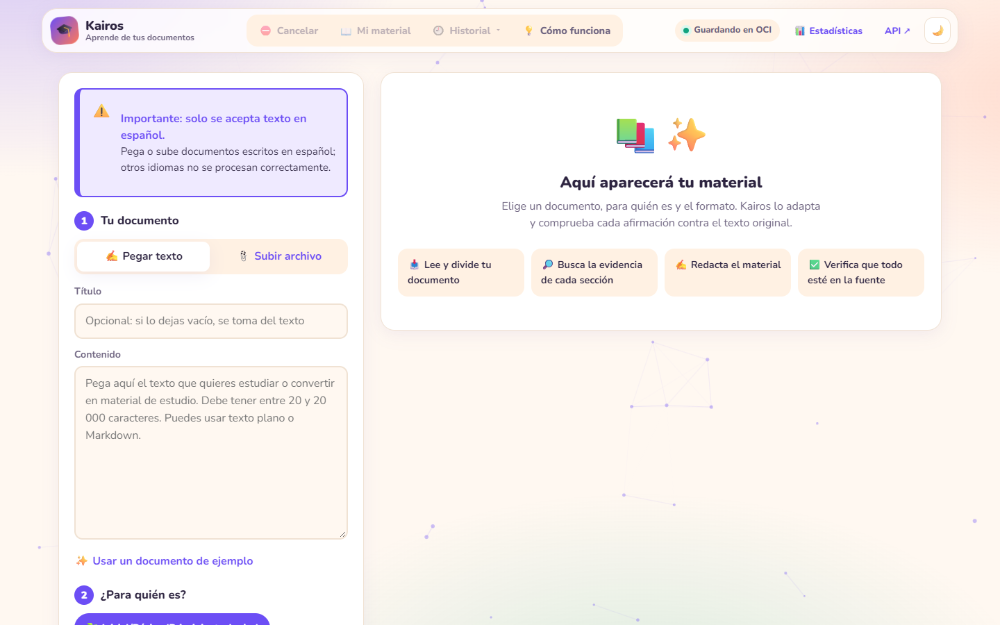

# Evidencia: diagnóstico del 401 de OCI y HU-64

**Fecha:** 2026-10-23  
**Rama:** `Ethan` sincronizada con `origin/main`  
**Commit:** `522beb4`  
**Entorno desplegado:** https://g10-latam-equipo-41-kairos.onrender.com/  
**Versión desplegada:** `1.5.0`

> Esta evidencia no incluye llaves, fingerprints, OCIDs ni contenido de archivos secretos.

---

## 1. Diagnóstico del error 401 de OCI

### Qué se comprobó

El error `401 NotAuthenticated` significa que OCI no reconoce las credenciales. La aplicación ahora captura ese error y lo traduce a un motivo legible en `/health`, en lugar de dejar solo el código técnico o de mostrar un falso “Guardando en OCI”.

Código relacionado:

- `src/nuevamente/storage/oci_client.py:105` → `_registrar_fallo()`
- `src/nuevamente/storage/oci_client.py:108` → mensaje específico para `401`
- `src/nuevamente/api/app.py:107` → `/health` devuelve `oci_disponible`
- `src/nuevamente/api/app.py:109` → `/health` devuelve `oci_motivo`

### Evidencia con un 401 simulado

Para no provocar un fallo real en producción, se usó un cliente falso que responde `401 NotAuthenticated`:

```json
{
  "escenario": "Simulacion local: OCI responde 401 NotAuthenticated",
  "comprobacion_real_de_conexion": {
    "oci_disponible": false,
    "oci_motivo": "OCI rechazó las credenciales (401): la llave de API del config no está registrada en la cuenta. Súbela en la consola de OCI (Mi perfil → Claves de API)."
  },
  "subida_con_401": {
    "status_upload": "fallido_local",
    "bucket": "nuevamente-contenidos-educativos",
    "objeto_id": "pruebas/diagnostico_401.txt"
  }
}
```

Archivo completo: [`diagnostico_401_simulado.json`](diagnostico_401_simulado.json)

**Resultado:** el 401 ya no queda oculto. El indicador pasa a `false`, `/health` explica la causa y la subida se deriva al respaldo local con `status_upload: "fallido_local"`.

### Estado actual en producción

```json
{"status":"ok","version":"1.5.0","oci_disponible":true,"oci_motivo":""}
```

Archivo completo: [`health_render.json`](health_render.json)

**Lectura:** en este momento OCI sí acepta las credenciales. `oci_motivo` está vacío porque no hay error que reportar. El diagnóstico del 401 queda listo para mostrarse si vuelve a ocurrir.

---

## 2. HU-64: indicador “Guardando en OCI” con comprobación real

### Qué se comprobó

Antes, el indicador podía mostrar “Guardando en OCI” solo porque existía el archivo de configuración. Ahora, antes de mostrar ese estado, la aplicación hace una consulta real y liviana a OCI (`get_namespace()`):

- Si OCI responde bien → **“Guardando en OCI”**.
- Si OCI rechaza las credenciales (401/403) o no encuentra el bucket (404) → **“Guardado local”** y el motivo.
- Si no se puede contactar con la API → **“API sin conexión”**.

Además, un fallo se recuerda durante 5 minutos para no gastar la cuota gratuita de OCI consultando en cada carga de la página.

Código relacionado:

- `src/nuevamente/storage/oci_client.py:83` → `disponible_oci()` con comprobación real
- `src/nuevamente/storage/oci_client.py:27` → pausa de 300 segundos tras un fallo
- `src/nuevamente/api/app.py:107` → `/health` expone el estado real
- `src/nuevamente/web/app.js:174` → la interfaz usa `oci_disponible`
- `src/nuevamente/web/app.js:179` → estado “Guardado local”
- `src/nuevamente/web/app.js:191` → estado “API sin conexión”

### Evidencia en la interfaz desplegada

Texto real obtenido de la interfaz:

```json
{
  "url": "https://g10-latam-equipo-41-kairos.onrender.com/",
  "indicador": "Guardando en OCI",
  "detalle": "Cada material se guarda en OCI Object Storage, en la nube de Oracle. Puedes volver a abrirlo desde el Historial.",
  "clases_css": "estado estado-ok"
}
```

Archivo completo: [`indicador_ui.json`](indicador_ui.json)

Capturas:

- Vista de la página: [`indicador_oci_pagina.png`](indicador_oci_pagina.png)
- Indicador recortado: [`indicador_oci_elemento.png`](indicador_oci_elemento.png)



**Resultado:** el indicador muestra “Guardando en OCI” con clase `estado-ok` porque la comprobación real contra OCI fue exitosa.

### Prueba automatizada de HU-64

`tests/test_api.py:533` → `test_oci_disponible_solo_si_acepta_las_credenciales`

La prueba simula un 401 y verifica que:

- `/health` devuelve `oci_disponible: false`.
- `oci_motivo` contiene `401`.
- La siguiente carga de la página no vuelve a consultar OCI (se respeta la pausa).
- La subida se guarda como `fallido_local`.

Resultado de la ejecución:

```text
tests/test_api.py::test_oci_disponible_solo_si_acepta_las_credenciales PASSED
3 passed, 66 deselected
```

Archivo completo: [`pytest_oci_hu64.txt`](pytest_oci_hu64.txt)

También se ejecutaron las pruebas de seguridad de OCI:

```text
tests/test_security.py::test_el_modulo_de_oci_no_desactiva_la_verificacion_ssl_del_proceso PASSED
3 passed
```

Archivo completo: [`pytest_seguridad_oci.txt`](pytest_seguridad_oci.txt)

---

## 3. Cómo reproducirlo

```powershell
# Estado real del servicio desplegado
curl.exe -sS https://g10-latam-equipo-41-kairos.onrender.com/health

# Pruebas de OCI y HU-64
.\.venv\Scripts\python.exe -m pytest tests/test_api.py -k "oci" -v

# Pruebas de seguridad de OCI
.\.venv\Scripts\python.exe -m pytest tests/test_security.py -v

# Simulación local de un 401 (sin tocar OCI real)
$env:PYTHONPATH = "src"
.\.venv\Scripts\python.exe docs\pruebas\evidencia_oci\simular_401.py docs\pruebas\evidencia_oci\diagnostico_401_simulado.json
```

---

## 4. Conclusión

| Tarea | Estado | Evidencia |
|---|---|---|
| Diagnóstico del 401 de OCI | ✅ Implementado y probado | Mensaje claro en `oci_motivo`, prueba con 401 simulado, `/health` de producción |
| HU-64: indicador con conexión real | ✅ Implementado y probado | `disponible_oci()` consulta OCI de verdad, prueba automatizada y captura de la interfaz |

En producción OCI está conectado (`oci_disponible: true`), por lo que el indicador muestra correctamente “Guardando en OCI”. Si las credenciales fallan de nuevo, el sistema mostrará “Guardado local” y explicará el motivo, incluido el caso 401.
